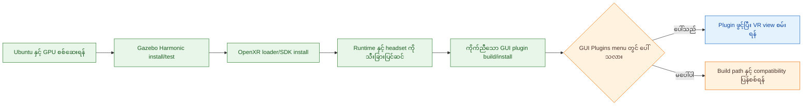

# $\color{#00c853}{\text{OpenXR PCVR ကို ပြင်ဆင်ခြင်း}}$

ဤညွှန်ကြားချက်သည် **Ubuntu 22.04 Jammy သို့မဟုတ် Ubuntu 24.04 Noble** တွင် Gazebo Harmonic ကို binary package ဖြင့် တပ်ဆင်ပြီး စမ်းသပ်ရန် ရည်ရွယ်သည်။ Windows သို့မဟုတ် အခြား Linux ဖြန့်ချိမှုများအတွက် အောက်ပါ `apt` command များကို အသုံးမပြုပါနှင့်။

> **အရေးကြီးသည်**: `gz-harmonic` နှင့် OpenXR loader/SDK တပ်ဆင်ခြင်းက OpenXR GUI plugin သို့မဟုတ် VR runtime ကို အလိုအလျောက် မတပ်ဆင်ပေးပါ။ Gazebo Harmonic နှင့် ကိုက်ညီသည့် OpenXR plugin/bridge နှင့် headset ကို ထောက်ပံ့သော OpenXR runtime ကို သီးခြားရွေးချယ်ရန် လိုအပ်သည်။ အတည်ပြုထားသော plugin repository တစ်ခု မသတ်မှတ်ရသေးသောကြောင့် plugin ကို download/build လုပ်သည့် command ကို ဤနေရာတွင် မခန့်မှန်းထားပါ။

## $\color{red}{\text{စက်ပတ်ဝန်းကျင်ကို စစ်ဆေးရန်}}$

Ubuntu version နှင့် architecture ကို အရင်စစ်ပါ။ Gazebo Harmonic binary package များကို Jammy နှင့် Noble အတွက် ပေးထားသည်။

```bash
cat /etc/os-release
uname -m
```

`VERSION_CODENAME=jammy` သို့မဟုတ် `VERSION_CODENAME=noble` ဖြစ်ကြောင်း စစ်ပါ။ GPU driver အလုပ်လုပ်နေပြီးသားဖြစ်ရမည်။ NVIDIA GPU သုံးပါက အောက်ပါ command ဖြင့် စစ်နိုင်သည်။

```bash
nvidia-smi
```

## $\color{red}{\text{Gazebo Harmonic တပ်ဆင်ရန်}}$

Gazebo ၏ official package repository ကို ထည့်ပြီး `gz-harmonic` ကို install လုပ်ပါ။

```bash
sudo apt-get update
sudo apt-get install curl lsb-release gnupg

sudo curl -fsSL \
  https://packages.osrfoundation.org/gazebo.gpg \
  -o /usr/share/keyrings/pkgs-osrf-archive-keyring.gpg

echo "deb [arch=$(dpkg --print-architecture) signed-by=/usr/share/keyrings/pkgs-osrf-archive-keyring.gpg] https://packages.osrfoundation.org/gazebo/ubuntu-stable $(lsb_release -cs) main" \
  | sudo tee /etc/apt/sources.list.d/gazebo-stable.list > /dev/null

sudo apt-get update
sudo apt-get install gz-harmonic
```

Version စာရင်းတွင် Gazebo 8 ရှိကြောင်းစစ်ပြီး sample world ကိုဖွင့်ပါ။ GUI တက်လာပါက `Ctrl+C` နှိပ်၍ ပိတ်နိုင်သည်။

```bash
gz sim --versions
gz sim --force-version 8 shapes.sdf
```

## $\color{red}{\text{OpenXR loader နှင့် SDK ကို ပြင်ဆင်ရန်}}$

အောက်ပါ package များသည် OpenXR application/plugin ကို run/build လုပ်ရာတွင် အသုံးပြုသည့် loader နှင့် development headers ဖြစ်သည်။ **ဤ package များသည် OpenXR runtime မဟုတ်သလို headset streaming ကိုလည်း မလုပ်ပေးပါ။**

```bash
sudo apt-get update
sudo apt-get install libopenxr-loader1 libopenxr-dev
```

Headset ကို PC နှင့် ချိတ်ဆက်ပြီး၊ ထို headset နှင့် Ubuntu ကို ပံ့ပိုးသော OpenXR runtime ကို runtime ထုတ်လုပ်သူ၏ညွှန်ကြားချက်အတိုင်း တပ်ဆင်ပါ။ Meta Quest Link/Air Link၊ ALVR၊ SteamVR နှင့် Monado တို့၏ Linux/Quest ပံ့ပိုးမှုနှင့် တပ်ဆင်ပုံ မတူညီသဖြင့် တစ်ခုချင်းစီ၏ official guide ကို လိုက်နာပါ။ Runtime အလုပ်လုပ်နေပြီး headset ကို တွေ့ရှိကြောင်း ၎င်း၏ app/console မှ စစ်ဆေးပါ။

OpenXR loader မှ runtime ကို ရှာဖွေရာတွင် အသုံးပြုသည့် environment variable နှင့် registered runtime manifest ကို စစ်ဆေးနိုင်သည်။

```bash
if [ -n "${XR_RUNTIME_JSON:-}" ]; then
  printf 'XR_RUNTIME_JSON=%s\n' "$XR_RUNTIME_JSON"
else
  echo "XR_RUNTIME_JSON ကို မသတ်မှတ်ထားပါ။ Registered runtime ကို အောက်တွင် စစ်ပါ။"
fi

for runtime_file in \
  /etc/xdg/openxr/1/active_runtime.json \
  "$HOME/.config/openxr/1/active_runtime.json"
do
  if [ -e "$runtime_file" ]; then
    printf '%s -> %s\n' "$runtime_file" "$(readlink -f "$runtime_file")"
  fi
done
```

Manifest မတွေ့ပါက runtime ကို ပြန်တပ်ဆင်ခြင်း သို့မဟုတ် active runtime သတ်မှတ်ခြင်းကို ထို runtime ၏ official instructions အတိုင်းလုပ်ပါ။ `XR_RUNTIME_JSON` သို့မဟုတ် `active_runtime.json` ကို မိမိစိတ်ကြိုက် မပြောင်းပါနှင့်၊ မှားယွင်းသည့် runtime ကို ရွေးမိနိုင်သည်။

## $\color{red}{\text{OpenXR GUI plugin ကို Gazebo တွင် ဖော်ထုတ်ရန်}}$

OpenXR GUI plugin/bridge ကို သီးခြားရွေးချယ်ပြီး ၎င်း၏ documentation အတိုင်း Gazebo Harmonic နှင့် ကိုက်ညီကြောင်း၊ build/install အောင်မြင်ကြောင်း အရင်စစ်ပါ။ Gazebo GUI သည် `GZ_GUI_PLUGIN_PATH` ထဲရှိ directory များမှ GUI plugin library များကို ရှာနိုင်သည်။ အောက်ပါ `PLUGIN_DIR` ကို plugin build/install ပြီးနောက် `.so` ဖိုင်ရှိသည့် directory ဖြင့် အစားထိုးပါ။

```bash
PLUGIN_DIR="$HOME/path/to/openxr-plugin/build"

if [ ! -d "$PLUGIN_DIR" ]; then
  echo "PLUGIN_DIR ကို plugin ၏ .so ဖိုင်ရှိသော directory ဖြင့် ပြင်ပါ။" >&2
  exit 1
fi

find "$PLUGIN_DIR" -maxdepth 2 -type f -name '*.so' -print

export GZ_GUI_PLUGIN_PATH="$PLUGIN_DIR${GZ_GUI_PLUGIN_PATH:+:$GZ_GUI_PLUGIN_PATH}"
printf 'GZ_GUI_PLUGIN_PATH=%s\n' "$GZ_GUI_PLUGIN_PATH"

gz sim --force-version 8 shapes.sdf
```

GUI ၏ **Plugins** menu တွင် plugin ပေါ်လာပါက ဖွင့်ပါ။ မပေါ်လာပါက plugin ၏ build/install log၊ `.so` တည်နေရာ၊ `GZ_GUI_PLUGIN_PATH` နှင့် Gazebo version ကို ပြန်စစ်ပါ။ Plugin တွင် သီးခြား GUI config ဖိုင်လိုအပ်ပါက ထို plugin ၏ညွှန်ကြားချက်ကို လိုက်နာပါ။ `GZ_GUI_PLUGIN_PATH` သည် plugin ကို ရှာဖွေရာတွင်သာ ကူညီပြီး OpenXR rendering ကို ကိုယ်တိုင်ထည့်ပေးခြင်း မဟုတ်ပါ။

## $\color{red}{\text{VR view ကို စမ်းသပ်ရန်}}$

Plugin နှင့် runtime နှစ်ခုစလုံး အလုပ်လုပ်ကြောင်းစစ်ပြီးနောက် sample world သို့မဟုတ် ကိုယ်ပိုင် world ကို ဖွင့်ပါ။ Headset pose လှုပ်ရှားမှု၊ left/right stereo view၊ tracking နှင့် frame rate ကို စစ်ဆေးပါ။ မျက်နှာပြင်မြင်ရုံသာဖြစ်ပြီး tracking မအလုပ်လုပ်ပါက runtime-headset ချိတ်ဆက်မှုနှင့် plugin ၏ OpenXR session ကို စစ်ပါ။

```bash
gz sim --force-version 8 shapes.sdf
```

ဤစာတမ်းတွင် ဖော်ပြထားသော command များသည် Gazebo နှင့် OpenXR loader/SDK ကို ပြင်ဆင်ရန်ဖြစ်သည်။ ကိုက်ညီသော OpenXR GUI plugin မရှိပါက အဆိုပါ command များဖြင့် VR view ကို ဖွင့်၍မရပါ။ Controller interaction အတွက် [02_interact.md](./02_interact.md)၊ robot control အတွက် [03_teleoperation.md](./03_teleoperation.md) ကို ဆက်ကြည့်ပါ။



References:
- [Gazebo Harmonic Ubuntu installation](https://gazebosim.org/docs/harmonic/install_ubuntu/)
- [Gazebo Harmonic GUI](https://gazebosim.org/docs/harmonic/gui/)
- [Gazebo GUI plugin discovery](https://gazebosim.org/api/gui/8/plugins.html)
- [Monado OpenXR runtime and loader](https://monado.freedesktop.org/getting-started.html)
- [ALVR installation guide](https://github.com/alvr-org/ALVR/wiki/Installation-guide)
