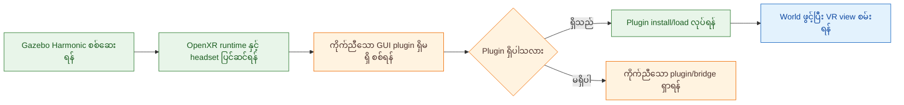

# $\color{#00c853}{\text{OpenXR PCVR ကို ပြင်ဆင်ခြင်း}}$

ဤစာတမ်းသည် Gazebo Harmonic simulation ကို PC မှ VR headset ဖြင့် ကြည့်ရန် လိုအပ်မည့် အဆင့်များကို အကြမ်းဖျဉ်းဖော်ပြထားသည်။

> **သတိပြုရန်**: Gazebo Harmonic GUI သည် OpenXR ကို ပုံမှန်အားဖြင့် အလိုအလျောက် မပံ့ပိုးပါ။ Gazebo version၊ rendering engine၊ operating system နှင့် ကိုက်ညီသော OpenXR GUI plugin သို့မဟုတ် bridge ကို သီးခြားတပ်ဆင်ပြီး စစ်ဆေးရန် လိုအပ်သည်။ Plugin မရှိလျှင် configuration သက်သက်ဖြင့် VR ကို ဖွင့်၍မရပါ။

## $\color{red}{\text{လိုအပ်မည့်အစိတ်အပိုင်းများ}}$

- OpenXR GUI plugin/bridge နှင့် ၎င်း၏ Gazebo Harmonic ကိုက်ညီမှု
- PC ပေါ်တွင် အလုပ်လုပ်နေသော OpenXR runtime
- Runtime နှင့် ချိတ်ဆက်ထားသော VR headset
- Gazebo Harmonic နှင့် လုပ်ဆောင်နိုင်သော GPU/driver

Headset ချိတ်ဆက်နည်းနှင့် OpenXR runtime ရွေးချယ်မှုသည် OS နှင့် headset အလိုက် ကွာခြားသည်။ မိမိစက်တွင် အမှန်တကယ်အသုံးပြုမည့် runtime ကို အရင်ရွေးချယ်ပါ။

## $\color{red}{\text{ပြင်ဆင်ရန်အဆင့်များ}}$

1. Gazebo Harmonic အလုပ်လုပ်ကြောင်း စမ်းသပ်ပါ။
2. အသုံးပြုမည့် OpenXR runtime ကို install/configure လုပ်ပြီး headset ကို runtime က တွေ့ရှိကြောင်း စစ်ဆေးပါ။
3. အသုံးပြုမည့် OpenXR GUI plugin/bridge ၏ installation နှင့် Gazebo Harmonic compatibility ကို အတည်ပြုပါ။
4. Plugin ၏ညွှန်ကြားချက်အတိုင်း plugin ကို build/install လုပ်ပြီး Gazebo GUI တွင် load လုပ်ပါ။ Plugin မပါရှိပါက ဤအဆင့်တွင် ရပ်ပြီး ကိုက်ညီသည့် implementation ကို ရှာဖွေရမည်။
5. Gazebo world ကိုဖွင့်၍ VR view ကို စမ်းသပ်ပါ။ Headset pose ပြောင်းလဲသောအခါ view လိုက်ပြောင်းခြင်း၊ frame rate နှင့် tracking တည်ငြိမ်မှုတို့ကို စစ်ဆေးပါ။

ဤအဆင့်တွင် ရည်ရွယ်ချက်မှာ VR ဖြင့် မြင်ကွင်းကြည့်ရှုနိုင်ရန်သာဖြစ်ပြီး controller input သို့မဟုတ် robot control ကို မပါဝင်သေးပါ။

References:
- [Gazebo Harmonic GUI](https://gazebosim.org/docs/harmonic/gui/)
- [Gazebo Harmonic installation](https://gazebosim.org/docs/harmonic/install/)
- [Gazebo GUI rendering plugins](https://github.com/gazebosim/gz-sim/blob/main/tutorials/rendering_plugins.md)
