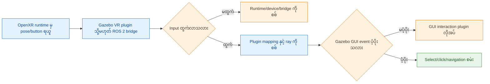

# $\color{#00c853}{\text{VR မှ Interaction လုပ်ခြင်း}}$

ဤအဆင့်တွင် Gazebo Harmonic scene ကို VR ဖြင့်ကြည့်ပြီး controller ဖြင့် scene သို့မဟုတ် GUI ကို ရွေးချယ်/နှိပ်/ရွှေ့ပြောင်းရန် ပြင်ဆင်သည်။ ဤစာတမ်း၏ environment သည် Ubuntu 22.04၊ ROS 2 Humble နှင့် PX4 v1.17 ဖြစ်သည်။

> **အရေးကြီးသည်**: Gazebo Harmonic၊ ROS 2 Humble နှင့် PX4 တို့က Quest controller ကို Gazebo GUI အတွက် အလိုအလျောက် map မလုပ်ပေးပါ။ ထိုအလုပ်အတွက် OpenXR GUI plugin သို့မဟုတ် OpenXR-to-ROS 2 bridge လိုအပ်သည်။ Plugin က ray selection၊ GUI click စသည့် feature များကို တိတိကျကျ ပံ့ပိုးမှသာ အောက်ပါ interaction များ အလုပ်လုပ်မည်။ PX4 ကို မောင်းနှင်ခြင်းသည် ဤအဆင့်မဟုတ်ဘဲ [03_teleoperation.md](./03_teleoperation.md) တွင် ဖော်ပြထားသည်။

## $\color{red}{\text{Interaction အဆင့်များ}}$

| လုပ်ဆောင်မှု | လိုအပ်သည့်အရာ | စစ်ဆေးရမည့်အချက် |
|---|---|---|
| Head tracking | OpenXR runtime နှင့် Gazebo-compatible VR view plugin | ခေါင်းလှည့်လျှင် view လိုက်လှည့်သလား |
| Controller tracking | Plugin မှ controller pose ကို ရယူနိုင်ခြင်း | Controller pose သည် runtime ထဲတွင် အပ်ဒိတ်ဖြစ်သလား |
| Object select/click | Controller ray သို့မဟုတ် equivalent pointer နှင့် Gazebo GUI event integration | Ray သည် object ကို ညွှန်ပြပြီး trigger ဖြင့် select လုပ်နိုင်သလား |
| Menu / GUI action | Button-to-GUI mapping | Button တစ်ခုချင်း၏ mapping ကို plugin configuration တွင် သတ်မှတ်ထားသလား |
| View navigation | Plugin က ပံ့ပိုးသော locomotion method | Teleport သို့မဟုတ် joystick movement ကို သီးခြား enable လုပ်ထားသလား |

Button နံပါတ်၊ trigger/grip mapping နှင့် teleport control သည် plugin တစ်ခုနှင့်တစ်ခု မတူနိုင်သောကြောင့် universal mapping ဟု မယူဆပါနှင့်။

## $\color{red}{\text{Gazebo နှင့် VR plugin ကို ဖွင့်ရန်}}$

[01_how_to_configure.md](./01_how_to_configure.md) တွင် Gazebo Harmonic၊ OpenXR runtime နှင့် plugin ကို ပြင်ဆင်ပြီးသားဖြစ်ရမည်။ Ubuntu 22.04 တွင် Harmonic GUI ကို ဖွင့်ပြီး Gazebo 8 ကို သုံးနေကြောင်း စစ်ပါ။

```bash
gz sim --versions
gz sim --force-version 8 shapes.sdf
```

Gazebo GUI ၏ **Plugins** menu ကိုဖွင့်၍ OpenXR/VR plugin ကို ရွေးပါ။ Plugin မပေါ်ပါက interaction ကို စမ်းမည့်အစား plugin build log၊ `.so` directory နှင့် `GZ_GUI_PLUGIN_PATH` ကို [01_how_to_configure.md](./01_how_to_configure.md) ကိုကြည့်ပြီး စစ်ပါ။ OpenXR runtime က headset နှင့် controller ကို အသိအမှတ်ပြုပြီး plugin သို့ pose/button input ပို့နေကြောင်းလည်း စစ်ဆေးပါ။

## $\color{red}{\text{ROS 2 Humble မှ controller input ကို စစ်ရန်}}$

Quest controller ကို ROS 2 node သို့ တိုက်ရိုက်ရောက်စေမည့် standard OpenXR topic တစ်ခု မရှိပါ။ Plugin/bridge က `sensor_msgs/msg/Joy` ကို `/joy` ပေါ် publish ပေးပါက၊ သို့မဟုတ် Linux က controller ကို SDL joystick အဖြစ် ဖော်ပြပါက အောက်ပါနည်းဖြင့် input ကို စစ်နိုင်သည်။

```bash
source /opt/ros/humble/setup.bash
sudo apt update
sudo apt install ros-humble-joy
ros2 run joy joy_enumerate_devices
```

Device list ထဲတွင် သင့် controller ရှိပါက terminal အသစ်တစ်ခုတွင် node ကို ဖွင့်ပါ။

```bash
source /opt/ros/humble/setup.bash
ros2 run joy joy_node
```

နောက် terminal တစ်ခုတွင် stick ကို ရွှေ့ပြီး button နှိပ်ကာ ရရှိသည့် `axes[]` နှင့် `buttons[]` index များကို မှတ်သားပါ။ Index များသည် controller သို့မဟုတ် driver အလိုက် ကွာနိုင်သည်။

```bash
source /opt/ros/humble/setup.bash
ros2 topic list -t
ros2 topic echo /joy
```

`/joy` မပေါ်ပါက `joy_node` သည် Quest controller ကို မတွေ့သေးခြင်းဖြစ်နိုင်သည်။ အဲဒီအခါ OpenXR runtime မှ controller action များကို ဖတ်ပြီး `/joy` သို့မဟုတ် plugin-specific input topic ထုတ်ပေးသည့် bridge ကို သီးခြားလိုအပ်သည်။ `joy_node` ကို run လုပ်ရုံဖြင့် Gazebo GUI ကို click လုပ်ပေးမည်မဟုတ်ပါ။

Plugin က `/joy` မဟုတ်သည့် topic ထုတ်ပါက ၎င်း၏ type နှင့် message ကို အရင်ရှာပါ။

```bash
PLUGIN_TOPIC="/replace/with/actual/topic"
ros2 topic list -t
ros2 topic info "$PLUGIN_TOPIC"
ros2 topic echo "$PLUGIN_TOPIC"
```

`PLUGIN_TOPIC` ကို plugin က အမှန်တကယ် ထုတ်ပေးသည့် topic ဖြင့် အစားထိုးပါ။ Controller pose ကို `geometry_msgs/msg/PoseStamped` အဖြစ်ထုတ်ပေးခြင်းနှင့် button များကို `sensor_msgs/msg/Joy` အဖြစ်ထုတ်ပေးခြင်းကဲ့သို့ output များကို plugin documentation ဖြင့် အတည်ပြုပါ။

## $\color{red}{\text{Gazebo interaction ကို စမ်းသပ်ရန်}}$

စမ်းသပ်မှုကို အောက်ပါအစဉ်အတိုင်းလုပ်ပါ။

1. Gazebo scene တွင် မြင်သာသော box သို့မဟုတ် model တစ်ခုကို ထားပါ။
2. Headset ကိုလှည့်ပြီး မြင်ကွင်း tracking ကို အရင်စစ်ပါ။
3. Controller pose ရွေ့လျားမှုကို plugin သို့မဟုတ် ROS 2 input topic တွင် အပ်ဒိတ်ဖြစ်ကြောင်း စစ်ပါ။
4. Plugin သတ်မှတ်ထားသော select trigger/ray ကို အသုံးပြုပြီး object ကို select လုပ်ပါ။
5. Menu click သို့မဟုတ် navigation ကို တစ်ခုချင်းစမ်းပြီး mapping နှင့် comfort ကို ပြန်စစ်ပါ။

Ray ရွေ့သော်လည်း object မရွေးနိုင်ပါက OpenXR tracking အလုပ်လုပ်နေသော်လည်း Gazebo GUI event integration မပါခြင်းဖြစ်နိုင်သည်။ Plugin က raycast/select ကို ပံ့ပိုးကြောင်း ပြန်စစ်ပါ။ ထို့အတူ view ပဲမြင်ရပြီး input မရပါက ၎င်းသည် display-only setup ဖြစ်နိုင်ပြီး interaction plugin သီးခြားလိုအပ်သည်။



## $\color{red}{\text{PX4 အတွက် နယ်ပယ်ခွဲခြားချက်}}$

ဤ interaction စမ်းသပ်မှုတွင် PX4 command topic များသို့ publish မလုပ်ပါ။ PX4 v1.17 SITL နှင့် ROS 2 Humble ချိတ်ဆက်မှုကို သီးခြားစစ်လိုပါက Micro XRCE-DDS Agent နှင့် PX4 SITL ကို ဖွင့်ပြီး `/fmu/` topic များ ရှိမရှိသာ ကြည့်ပါ။ Controller input ကို PX4 သို့ ပို့မည့် နမူနာကို [03_teleoperation.md](./03_teleoperation.md) တွင် ဖော်ပြထားသည်။

```bash
source /opt/ros/humble/setup.bash
ros2 topic list
ros2 topic echo /fmu/out/vehicle_status --qos-reliability best_effort --once
```

References:
- [01_how_to_configure.md](./01_how_to_configure.md)
- [Gazebo Harmonic GUI](https://gazebosim.org/docs/harmonic/gui/)
- [Gazebo GUI plugin discovery](https://gazebosim.org/api/gui/8/plugins.html)
- [ROS 2 Humble joy package](https://docs.ros.org/en/humble/p/joy/)
- [PX4 v1.17 ROS 2 guide](https://docs.px4.io/v1.17/en/ros2/user_guide)
