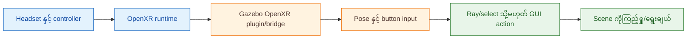

# $\color{#00c853}{\text{VR မှ Interaction လုပ်ခြင်း}}$

ဤအဆင့်တွင် VR view ထဲမှ controller သုံးပြီး scene သို့မဟုတ် Gazebo GUI ကို ရိုးရှင်းစွာ ထိန်းချုပ်နိုင်ရန် ရည်ရွယ်သည်။ လုပ်ဆောင်နိုင်သည့် interaction များသည် OpenXR plugin/bridge က ပံ့ပိုးထားသော input များပေါ် မူတည်သည်။

## $\color{red}{\text{လုပ်ဆောင်ပုံအကြမ်း}}$

1. OpenXR plugin/bridge မှ headset pose နှင့် controller pose/button များကို ရယူသည်။
2. Controller ray သို့မဟုတ် input ကို scene/GUI action နှင့် ချိတ်ဆက်သည်။
3. Select၊ click သို့မဟုတ် view navigation ကဲ့သို့ action များကို စမ်းသပ်သည်။
4. Robot ကို မောင်းနှင်ခြင်း သို့မဟုတ် joint များကို အမိန့်ပေးခြင်း မပါဝင်သေးပါ။

Controller input mapping၊ ray selection နှင့် locomotion တို့ကို plugin က ပံ့ပိုးမှုရှိမရှိ သီးခြားအတည်ပြုရမည်။ Robot ကို တကယ်ထိန်းချုပ်ရန် လိုအပ်ပါက [03_teleoperation.md](./03_teleoperation.md) ကို ဆက်ကြည့်ပါ။

References:
- [Gazebo Harmonic GUI](https://gazebosim.org/docs/harmonic/gui/)
- [Gazebo GUI rendering plugins](https://github.com/gazebosim/gz-sim/blob/main/tutorials/rendering_plugins.md)
