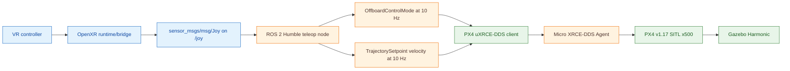

# $\color{#00c853}{\text{VR ဖြင့် PX4 Drone ကို ထိန်းချုပ်ခြင်း}}$

ဤနမူနာသည် **Ubuntu 22.04၊ ROS 2 Humble၊ PX4 v1.17၊ Gazebo Harmonic** ပေါ်ရှိ PX4 `x500` **SITL simulation အတွက်သာ** ဖြစ်သည်။ VR controller input ကို ROS 2 `sensor_msgs/msg/Joy` အဖြစ် `/joy` ပေါ်ရောက်စေပြီး PX4 Offboard velocity setpoint သို့ ပြောင်းပို့သည်။

> **Safety**: ဤနမူနာကို real flight controller သို့မဟုတ် တကယ့် drone နှင့် မချိတ်ပါနှင့်။ Code သည် arm သို့မဟုတ် Offboard mode ပြောင်းရန် command မပို့ပါ။ SITL/QGroundControl မှသာ mode/arming ကို ကိုယ်တိုင်စမ်းသပ်ပါ။ Joystick ပျောက်သွားလျှင် node သည် velocity ကို သုညသို့ပြန်ပို့မည်။ Node ကိုရပ်လိုက်လျှင် PX4 Offboard failsafe အလုပ်လုပ်နိုင်သဖြင့် QGroundControl မှ safe mode သို့ အရင်ပြောင်းပါ။

## $\color{red}{\text{လုပ်ဆောင်ပုံ}}$



ဤ mapping သည် PX4 local **NED** frame ကို သုံးသည်: X/Y သည် မြေပြင်ပေါ်ရွေ့လျားမှု၊ Z သည် အောက်ဘက် positive ဖြစ်သည်။ ထို့ကြောင့် joystick ကို အပေါ်သို့တွန်းသည့်အခါ node က negative Z velocity ပို့သည်။ ဤနမူနာသည် headset/head direction အလိုက် မလှည့်ဘဲ local frame အလိုက် ထိန်းချုပ်သည်။

## $\color{red}{\text{လိုအပ်ချက်နှင့် ချိတ်ဆက်မှု}}$

PX4 source checkout သည် v1.17 ဖြစ်ကြောင်း အရင်စစ်ပါ။ `PX4-Autopilot` သည် ကိုယ်ပိုင်တည်နေရာတွင်ရှိပါက `cd` path ကို ပြောင်းပါ။

```bash
cd ~/PX4-Autopilot
git describe --tags --always
```

### $\color{cyan}{\text{PX4 ROS 2 message package ကို တည်ဆောက်ရန်}}$

PX4 v1.17 message definition နှင့်ကိုက်ညီသည့် `px4_msgs` `release/1.17` branch ကို အသုံးပြုပါ။

```bash
sudo apt update
sudo apt install python3-colcon-common-extensions python3-rosdep ros-humble-joy

source /opt/ros/humble/setup.bash
if [ ! -f /etc/ros/rosdep/sources.list.d/20-default.list ]; then
  sudo rosdep init
fi
rosdep update
mkdir -p ~/px4_ros2_ws/src
cd ~/px4_ros2_ws/src
git clone --branch release/1.17 https://github.com/PX4/px4_msgs.git

cd ~/px4_ros2_ws
rosdep install --from-paths src --ignore-src -r -y
colcon build --symlink-install
source install/setup.bash
```

Message version မကိုက်ပါက PX4 နှင့် ROS 2 အကြား topic/message mismatch ဖြစ်နိုင်သည်။ Firmware နှင့် `px4_msgs` ကို release တူအောင်ထားပါ။

### $\color{cyan}{\text{Micro XRCE-DDS Agent ကို တည်ဆောက်ရန်}}$

PX4 v1.17 ၏ SITL client က localhost UDP port `8888` ကို အသုံးပြုသည်။ ROS 2 Humble အတွက် PX4 guide က Micro XRCE-DDS Agent `v2.4.2` ကို သတ်မှတ်ထားသည်။

```bash
sudo apt install build-essential cmake
cd ~
git clone --branch v2.4.2 https://github.com/eProsima/Micro-XRCE-DDS-Agent.git
cd ~/Micro-XRCE-DDS-Agent
cmake -S . -B build
cmake --build build --parallel
sudo cmake --install build
sudo ldconfig /usr/local/lib/
```

### $\color{cyan}{\text{SITL နှင့် Agent ကို ဖွင့်ရန်}}$

ပထမ terminal တွင် Agent ကို ဖွင့်ထားပါ။

```bash
MicroXRCEAgent udp4 -p 8888
```

ဒုတိယ terminal တွင် Gazebo Harmonic ပါသော PX4 v1.17 SITL ကို ဖွင့်ပါ။

```bash
cd ~/PX4-Autopilot
make px4_sitl gz_x500
```

တတိယ terminal တွင် ROS 2 workspace ကို source လုပ်ပြီး PX4 topics ပေါ်လာကြောင်း စစ်ပါ။

```bash
source /opt/ros/humble/setup.bash
source ~/px4_ros2_ws/install/setup.bash
ros2 topic list
```

အောက်ပါ PX4 input topics ရှိရမည်။

- `/fmu/in/offboard_control_mode`
- `/fmu/in/trajectory_setpoint`

### $\color{cyan}{\text{Controller input ကို စစ်ရန်}}$

ဤနမူနာသည် `/joy` ကို ဖတ်သည်။ OpenXR runtime သို့မဟုတ် bridge က Quest controller ကို SDL joystick အဖြစ် မဖော်ပြပါက `joy_node` တစ်ခုတည်းဖြင့် input မရနိုင်ပါ။ ထိုအခြေအနေတွင် OpenXR controller action များကို `sensor_msgs/msg/Joy` အဖြစ် `/joy` သို့ publish ပေးသည့် bridge ကို သီးခြားလိုအပ်သည်။

Linux က controller ကို joystick အဖြစ် တွေ့ပါက device နှင့် button/axis index များကို စစ်ပါ။

```bash
source /opt/ros/humble/setup.bash
ros2 run joy joy_enumerate_devices
ros2 run joy joy_node --ros-args -p autorepeat_rate:=20.0
```

Terminal အသစ်တွင် stick ကို ရွှေ့ပြီး button နှိပ်ကြည့်ပါ။ `axes[]` နှင့် `buttons[]` index များသည် controller အလိုက်မတူနိုင်သောကြောင့် မိမိစက်တွင် ထွက်လာသည့်တန်ဖိုးများကို အခြေခံပါ။

```bash
source /opt/ros/humble/setup.bash
ros2 topic echo /joy
```

## $\color{red}{\text{နမူနာ ROS 2 node}}$

အောက်ပါ code ကို `~/px4_ros2_ws/joy_to_px4.py` အဖြစ် သိမ်းပါ။ Joystick axis/button mapping မကိုက်ပါက `forward_axis`၊ `right_axis`၊ `up_axis`၊ သက်ဆိုင်ရာ `*_sign` နှင့် `deadman_button` parameter များကို ပြင်ပါ။ Deadman button ကို ဖိထားမှသာ ရွေ့လျားမှုကို ပို့သည်။ Joy message မရတော့သည်မှာ 0.5 စက္ကန့်ကျော်လျှင် velocity ကို သုညထားသည်။ Input publisher သည် 10 Hz ထက်မြန်သော rate ဖြင့် message များ ဆက်တိုက်ပို့နေရမည်။ Stick drift လျော့စေရန် `deadzone` ကိုလည်း သုံးထားသည်။

```python
import math

import rclpy
from rclpy.node import Node
from sensor_msgs.msg import Joy
from px4_msgs.msg import OffboardControlMode, TrajectorySetpoint


class JoyToPx4(Node):
    def __init__(self):
        super().__init__("joy_to_px4")
        self.declare_parameter("forward_axis", 1)
        self.declare_parameter("right_axis", 0)
        self.declare_parameter("up_axis", 3)
        self.declare_parameter("forward_sign", 1.0)
        self.declare_parameter("right_sign", 1.0)
        self.declare_parameter("up_sign", 1.0)
        self.declare_parameter("deadman_button", 0)
        self.declare_parameter("max_xy_speed", 1.0)
        self.declare_parameter("max_z_speed", 0.5)
        self.declare_parameter("deadzone", 0.1)

        self.forward_axis = self.get_parameter("forward_axis").value
        self.right_axis = self.get_parameter("right_axis").value
        self.up_axis = self.get_parameter("up_axis").value
        self.forward_sign = self.get_parameter("forward_sign").value
        self.right_sign = self.get_parameter("right_sign").value
        self.up_sign = self.get_parameter("up_sign").value
        self.deadman_button = self.get_parameter("deadman_button").value
        self.max_xy_speed = self.get_parameter("max_xy_speed").value
        self.max_z_speed = self.get_parameter("max_z_speed").value
        self.deadzone = self.get_parameter("deadzone").value
        self.axes = []
        self.deadman = False
        self.last_joy_time = None

        self.create_subscription(Joy, "/joy", self.joy_callback, 10)
        self.mode_pub = self.create_publisher(
            OffboardControlMode, "/fmu/in/offboard_control_mode", 10
        )
        self.setpoint_pub = self.create_publisher(
            TrajectorySetpoint, "/fmu/in/trajectory_setpoint", 10
        )
        self.create_timer(0.1, self.publish_setpoints)

    def joy_callback(self, msg):
        self.axes = list(msg.axes)
        self.deadman = (
            0 <= self.deadman_button < len(msg.buttons)
            and msg.buttons[self.deadman_button] == 1
        )
        self.last_joy_time = self.get_clock().now()

    def axis(self, index):
        if index < 0 or index >= len(self.axes):
            return 0.0
        value = max(-1.0, min(1.0, float(self.axes[index])))
        return 0.0 if abs(value) < self.deadzone else value

    def publish_setpoints(self):
        now = self.get_clock().now()
        timestamp = now.nanoseconds // 1000
        joy_is_fresh = (
            self.last_joy_time is not None
            and (now - self.last_joy_time).nanoseconds < 500_000_000
        )
        enabled = self.deadman and joy_is_fresh

        vx = (
            self.forward_sign * self.axis(self.forward_axis) * self.max_xy_speed
            if enabled
            else 0.0
        )
        vy = (
            self.right_sign * self.axis(self.right_axis) * self.max_xy_speed
            if enabled
            else 0.0
        )
        vz = (
            -self.up_sign * self.axis(self.up_axis) * self.max_z_speed
            if enabled
            else 0.0
        )

        mode = OffboardControlMode()
        mode.timestamp = timestamp
        mode.position = False
        mode.velocity = True
        mode.acceleration = False
        mode.attitude = False
        mode.body_rate = False
        mode.thrust_and_torque = False
        mode.direct_actuator = False
        self.mode_pub.publish(mode)

        setpoint = TrajectorySetpoint()
        setpoint.timestamp = timestamp
        setpoint.position = [math.nan, math.nan, math.nan]
        setpoint.velocity = [vx, vy, vz]
        setpoint.acceleration = [math.nan, math.nan, math.nan]
        setpoint.jerk = [math.nan, math.nan, math.nan]
        setpoint.yaw = math.nan
        setpoint.yawspeed = 0.0
        self.setpoint_pub.publish(setpoint)


def main(args=None):
    rclpy.init(args=args)
    node = JoyToPx4()
    try:
        rclpy.spin(node)
    except KeyboardInterrupt:
        pass
    finally:
        node.destroy_node()
        rclpy.shutdown()


if __name__ == "__main__":
    main()
```

`TrajectorySetpoint` သည် local NED frame ကို သုံးသည်။ `math.nan` သတ်မှတ်ထားသော position/acceleration/yaw fields များကို control မလုပ်ရန် ဆိုလိုသည်။ Node သည် 10 Hz ဖြင့် Offboard heartbeat နှင့် velocity setpoint ပို့သော်လည်း **arm/mode ပြောင်းရန် command မပို့ပါ**။

## $\color{red}{\text{နမူနာကို စမ်းသပ်ရန်}}$

Agent၊ SITL နှင့် `/joy` publisher အလုပ်လုပ်နေပြီးနောက် terminal အသစ်တွင် node ကို run ပါ။

```bash
source /opt/ros/humble/setup.bash
source ~/px4_ros2_ws/install/setup.bash
python3 ~/px4_ros2_ws/joy_to_px4.py --ros-args \
  -p forward_axis:=1 \
  -p right_axis:=0 \
  -p up_axis:=3 \
  -p deadman_button:=0
```

Message များထွက်နေကြောင်း စစ်ပါ။

```bash
ros2 topic echo /fmu/in/offboard_control_mode
ros2 topic echo /fmu/in/trajectory_setpoint
```

QGroundControl တွင် **SITL x500** ကိုသာ ချိတ်ထားကြောင်း အတည်ပြုပြီး၊ setpoint stream အနည်းဆုံး 1 စက္ကန့်ထက်ပို၍ ဆက်လက်ထွက်နေကြောင်း စစ်ဆေးပြီးနောက် Offboard mode နှင့် arming ကို simulation ထဲတွင်သာ ကိုယ်တိုင်စမ်းပါ။ Joystick mapping မှန်ကန်ကြောင်း အရင်စစ်ပြီး၊ လှုပ်ရှားမှုအနည်းငယ်ဖြင့် စမ်းပါ။ Controller ကိုလွှတ်လိုက်ပါက node က velocity သုည ပို့သော်လည်း PX4 Offboard heartbeat ဆက်ရှိနေမည်။

စမ်းသပ်မှုပြီးလျှင် QGroundControl မှ Offboard မှ safe mode သို့ ပြန်ပြောင်းပြီးမှ node ကို `Ctrl+C` ဖြင့်ရပ်ပါ။ Node ရပ်ချိန် Offboard mode ထဲတွင် ဆက်နေနေပါက PX4 က Offboard loss failsafe ကို လုပ်ဆောင်မည်ဖြစ်သည်။

References:
- [PX4 v1.17 ROS 2 user guide](https://docs.px4.io/v1.17/en/ros2/user_guide)
- [PX4 v1.17 uXRCE-DDS](https://docs.px4.io/v1.17/en/middleware/uxrce_dds)
- [PX4 v1.17 Offboard control](https://docs.px4.io/v1.17/en/ros2/offboard_control)
- [PX4 v1.17 Gazebo simulation](https://docs.px4.io/v1.17/en/sim_gazebo_gz/)
- [ROS 2 Humble joy package](https://docs.ros.org/en/humble/p/joy/)
- [PX4 `px4_msgs` release/1.17](https://github.com/PX4/px4_msgs/tree/release/1.17)
