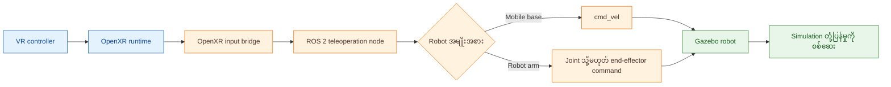

# $\color{#00c853}{\text{VR ဖြင့် Robot Teleoperation}}$

Teleoperation ဆိုသည်မှာ VR controller မှ ရလာသော input များကို ROS 2 သို့မဟုတ် Gazebo control interface မှတစ်ဆင့် robot command အဖြစ် ပြောင်းပို့ခြင်းဖြစ်သည်။ ဤအဆင့်တွင် bridge/node နှင့် robot အတွက် သင့်တော်သော control mapping လိုအပ်သည်။

## $\color{red}{\text{လုပ်ဆောင်ပုံအကြမ်း}}$

1. OpenXR မှ controller pose၊ joystick နှင့် button များကို ရယူသည်။
2. Bridge သို့မဟုတ် ROS 2 node က input များကို robot command အဖြစ် ပြောင်းသည်။
3. ဥပမာ mobile robot အတွက် `cmd_vel`၊ arm အတွက် joint trajectory သို့မဟုတ် end-effector target ကို ပို့သည်။
4. Gazebo simulation မှ တုံ့ပြန်မှုကို စောင့်ကြည့်ပြီး mapping ကို စမ်းသပ်ချိန်ညှိသည်။

Input scale၊ coordinate frame၊ control rate နှင့် safety stop စသည်တို့ကို robot model နှင့် အသုံးပြုမည့် control stack အလိုက် သတ်မှတ်ရမည်။ အသေးစိတ် implementation ကို နောက်အဆင့်တွင် သီးခြားရေးသားနိုင်သည်။

References:
- [Gazebo Harmonic GUI](https://gazebosim.org/docs/harmonic/gui/)
- [Gazebo GUI rendering plugins](https://github.com/gazebosim/gz-sim/blob/main/tutorials/rendering_plugins.md)
