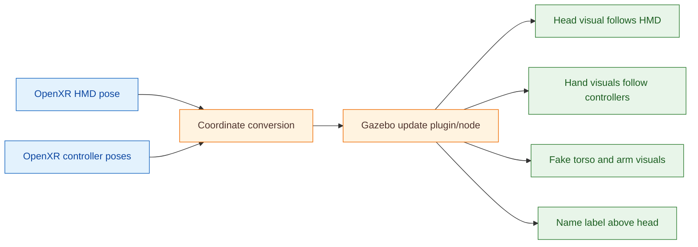

# $\color{#00c853}{\text{VR သုံးသူ၏ Fake Human Model ကို Simulator ထဲ ထည့်ခြင်း}}$

**ရပါတယ်။** Body tracking နဲ့ IK မလိုပါ။ Gazebo ထဲက fake avatar ရဲ့ ဦးခေါင်းကို VR headset pose၊ လက်တွေကို controller pose အတိုင်း ရွှေ့ပြီး ကိုယ်ထည်ကို ရိုးရှင်းတဲ့ fixed pose အဖြစ်ထားနိုင်ပါတယ်။ လူပုံစံအပြည့်အဝ လှုပ်ရှားသလို မြင်ရမည်မဟုတ်ပေမဲ့ VR သုံးသူကို simulator ထဲမှာ ကိုယ်စားပြုဖို့ လုံလောက်နိုင်ပါတယ်။

## $\color{red}{\text{လိုအပ်ချက်အလိုက် လုပ်ဆောင်ပုံ}}$

| ရည်ရွယ်ချက် | နည်းလမ်း | လိုအပ်ချက် |
|---|---|---|
| လူပုံစံကို ကမ္ဘာထဲမှာထားရန် | SDF human model ကို ထည့်ရန် | model mesh နှင့် pose |
| Head/controller အတိုင်း ရွှေ့ရန် | HMD ကို head၊ controller များကို လက်အဖြစ် map လုပ်ရန် | OpenXR pose input နှင့် Gazebo update plugin/node |
| Fake ကိုယ်ထည် ပြရန် | ရိုးရှင်းသော torso၊ လက်မောင်းနှင့် hand visuals သုံးရန် | fixed offset များသာ၊ body tracking/IK မလို |
| နာမည်ပြရန် | Entity name သို့မဟုတ် floating text label သုံးရန် | ကမ္ဘာထဲတွင် ပေါ်စေလိုလျှင် rendering/GUI plugin လို |

Gazebo Harmonic `actor` သည် ကြိုတင်သတ်မှတ်ထားသော skeleton animation အတွက်ဖြစ်သည်။ ဤလိုအပ်ချက်အတွက် scripted actor animation မလိုဘဲ visual-only model ကို pose update လုပ်ခြင်းက ပိုရိုးရှင်းသည်။ Model ကို physics collision မပါဘဲထားလျှင် fake avatar က robot/simulation ကို မတော်တဆ မထိခိုက်စေပါ။

## $\color{red}{\text{Human Model နှင့် နာမည်ကို ထည့်ရန်}}$

SDF world ထဲတွင် လူ model ကို include လုပ်ပြီး instance name သတ်မှတ်နိုင်သည်။

```xml
<include>
  <uri>model://human_model</uri>
  <name>vr_user_asha</name>
  <pose>0 0 0 0 0 0</pose>
</include>
```

`model://human_model` နေရာတွင် မိမိအသုံးပြုမည့် model URI သို့မဟုတ် SDF model ကို ထည့်ပါ။ `vr_user_asha` သည် Gazebo Entity Tree ထဲတွင် ပေါ်မည့် entity name ဥပမာဖြစ်သည်။ ၎င်းကို world ထဲက လူပုံအပေါ်တွင် စာတန်းအဖြစ် ပြချင်ပါက SDF entity name တစ်ခုတည်းနဲ့ မလုံလောက်ပါ။

မြင်ကွင်းထဲတွင် ဦးခေါင်းအပေါ်ကပ်၍ လိုက်နေသော နာမည်စာတန်းလိုပါက Gazebo Rendering `Text` geometry ကို သုံးသည့် rendering/GUI plugin ဖြင့် billboard text ဖန်တီးပြီး head pose အပေါ် offset တစ်ခုထားပါ။ နာမည်ကို ပြောင်းလဲနိုင်စေလိုပါက plugin configuration သို့မဟုတ် ROS 2 topic မှ label text ကို သတ်မှတ်နိုင်သည်။ ပုံပေါ်စေရန်သာလိုလျှင် avatar ကိုယ်ထည်အပေါ် text image ပါသော plane တစ်ခုတပ်ခြင်းလည်း ရိုးရှင်းသော အစားထိုးနည်းဖြစ်သည်။

## $\color{red}{\text{Head နှင့် Controller အတိုင်း Fake Avatar ရွှေ့ရန်}}$

1. OpenXR runtime သို့မဟုတ် VR plugin မှ HMD နှင့် ဘယ်/ညာ controller pose များကို ရယူပါ။
2. OpenXR coordinate frame နှင့် Gazebo world frame မတူနိုင်သောကြောင့် axis၊ origin နှင့် scale ကို တစ်ကြိမ်တည်း မှန်ကန်စွာ ပြောင်းပါ။
3. HMD pose ကို avatar ၏ head visual သို့ တိုက်ရိုက်လိုက်စေပါ။
4. Controller pose များကို hand visual များသို့ တိုက်ရိုက်လိုက်စေပါ။ လက်မောင်းကို ပခုံးမှ hand အထိ cylinder/line visual ဖြင့် ဆက်ပြနိုင်ပြီး IK မလိုပါ။
5. Torso ကို head အောက်တွင် fixed offset ထားပါ။ လိုချင်ပါက HMD yaw ကိုသာ လိုက်စေပြီး body pose ကို ရိုးရှင်းစွာ ထားပါ။
6. Floating name label ကို head အပေါ်တွင် သတ်မှတ်ထားသော offset ဖြင့် လိုက်ရွှေ့ပါ။



ဤပုံစံတွင် body tracking မရှိသော်လည်း ပြဿနာမဟုတ်ပါ။ ကိုယ်ထည်နှင့် လက်မောင်းများသည် အနီးစပ်ဆုံးပြသသော fake visuals ဖြစ်ပြီး၊ OpenXR GUI plugin တိုင်းက avatar model ကို အလိုအလျောက် ဖန်တီးပေးသည်ဟု မယူဆပါနှင့်။ Head/controller pose ကို Gazebo model/actor သို့ ပို့မည့် plugin သို့မဟုတ် ROS 2 node ကို သီးခြားရွေးချယ်/ရေးသားရန် လိုသည်။

## $\color{red}{\text{ဤ Project အတွက် အကြံပြုထားသော ပထမအဆင့်}}$

Ubuntu 22.04၊ ROS 2 Humble နှင့် Gazebo Harmonic တွင် ပထမဦးစွာ visual-only human model နှင့် Entity Tree name ကို ထည့်ပါ။ ထို့နောက် OpenXR မှ HMD/controller pose များ ရနိုင်ကြောင်း စစ်ပြီး head/hand visuals နှင့် name label ကို update လုပ်ပါ။ Body tracking၊ IK နှင့် physics collision ကို မထည့်ဘဲထားနိုင်သည်။

ဤ avatar feature သည် [01_how_to_configure.md](./01_how_to_configure.md) ရှိ PCVR view၊ [02_interact.md](./02_interact.md) ရှိ GUI interaction၊ [03_teleoperation.md](./03_teleoperation.md) ရှိ PX4 teleoperation တို့မှ သီးခြားလုပ်ဆောင်ချက်ဖြစ်သည်။

References:
- [Gazebo Harmonic actors](https://gazebosim.org/docs/harmonic/actors/)
- [Gazebo Rendering 8 text geometry](https://gazebosim.org/api/rendering/8/text_geom.html)
- [ROS 2 Humble ros_gz_sim](https://docs.ros.org/en/humble/p/ros_gz_sim/)
