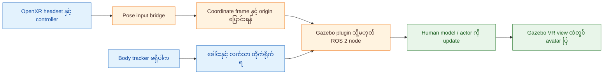

# $\color{#00c853}{\text{VR သုံးသူ၏ Human Model ကို Simulator ထဲ ထည့်ခြင်း}}$

**ရပါတယ်။** Gazebo Harmonic world ထဲတွင် လူပုံစံကို ရုပ်ပုံအဖြစ် ထည့်နိုင်ပြီး၊ လိုအပ်ပါက VR headset/controller ရွေ့လျားမှုအတိုင်းလည်း လိုက်လှုပ်ရှားစေနိုင်သည်။ သို့သော် ပုံသေ model၊ ကြိုတင်သတ်မှတ်ထားသော animation နှင့် live VR avatar တို့သည် အဆင့်ကွာခြားသည်။

## $\color{red}{\text{ရွေးချယ်နိုင်သည့် နည်းလမ်းများ}}$

| ရည်ရွယ်ချက် | နည်းလမ်း | ကန့်သတ်ချက် |
|---|---|---|
| လူပုံစံကို မြင်ကွင်းထဲတွင် ထားရန် | SDF human model ကို world ထဲ include/spawn လုပ်ရန် | မိမိ pose အတိုင်း အလိုအလျောက်မရွေ့ပါ |
| ကြိုတင်သတ်မှတ်ထားသော လှုပ်ရှားမှု ပြရန် | Gazebo `actor` နှင့် `.dae`/`.bvh` skeleton animation သုံးရန် | Scripted trajectory ဖြစ်ပြီး physics collision မရှိပါ |
| Headset နှင့် လက်/controller အတိုင်း လိုက်စေရန် | OpenXR pose များကို ROS 2 သို့မဟုတ် Gazebo plugin မှတစ်ဆင့် avatar pose သို့ ပြောင်းရန် | ကိုက်ညီသော bridge/plugin နှင့် frame conversion လိုအပ်သည် |
| ကိုယ်တစ်ခုလုံး၏ လှုပ်ရှားမှုကို ပြရန် | Body tracker များ သို့မဟုတ် IK ဖြင့် ခန့်မှန်းထားသော skeleton ကို အသုံးပြုရန် | Headset/controller သာရှိလျှင် ခြေထောက်နှင့် ကိုယ်ခန္ဓာ pose အမှန်ကို မရနိုင်ပါ |

Gazebo ၏ `actor` သည် animated visual အတွက် အဆင်ပြေသည်။ Actor များသည် gravity/contact force မခံယူသဖြင့် ပုံမှန်အားဖြင့် အခြား object များနှင့် တိုက်မိမှု simulation မလုပ်ပါ။ Avatar က object ကို ကိုင်တွယ်ခြင်း သို့မဟုတ် collision ဖြစ်စေလိုပါက physics-enabled link/joint များပါသော SDF model နှင့် သီးခြား control logic လိုအပ်သည်။

## $\color{red}{\text{တည်ငြိမ်နေသော Human Model ထည့်ရန်}}$

ကိုယ်ပိုင် သို့မဟုတ် အသုံးပြုခွင့်ရှိသည့် human model ကို SDF model အဖြစ် Gazebo world ထဲ ထည့်ပါ။ အောက်ပါသည် world SDF ထဲတွင် `model://human_model` model ကို နေရာချထားသည့် ဥပမာဖြစ်သည်။

```xml
<include>
  <uri>model://human_model</uri>
  <pose>0 0 0 0 0 0</pose>
</include>
```

`human_model` နေရာတွင် မိမိ၏ model URI သို့မဟုတ် model directory ကို ထည့်ပါ။ Mesh, scale နှင့် pose ကို SDF model configuration နှင့် ကိုက်ညီအောင်ပြင်ပါ။ ရုပ်ပုံပြရန်သာလိုပါက collision geometry မပါသည့် visual-only model ကို သုံးခြင်းဖြင့် မလိုအပ်သော collision များကို ရှောင်နိုင်သည်။

## $\color{red}{\text{Actor ဖြင့် ကြိုတင် Animation ပြရန်}}$

Gazebo Harmonic `actor` သည် skeleton animation နှင့် SDF ထဲမှ scripted trajectory ကို ပြနိုင်သည်။ အောက်ပါ fragment ကို world SDF ၏ `<world>` အတွင်း ထည့်ပြီး `human.dae` နှင့် `walk.dae` ကို မိမိ၏ asset path ဖြင့် အစားထိုးပါ။ Skin နှင့် animation skeleton များ ကိုက်ညီရမည်။

```xml
<actor name="human_actor">
  <skin>
    <filename>path/to/human.dae</filename>
    <scale>1.0</scale>
  </skin>
  <animation name="walk">
    <filename>path/to/walk.dae</filename>
    <interpolate_x>true</interpolate_x>
  </animation>
</actor>
```

Actor ၏ တည်နေရာလမ်းကြောင်းကို `<script>` အပိုင်းတွင် waypoint များဖြင့် ကြိုတင်သတ်မှတ်နိုင်သည်။ ၎င်းသည် VR အသုံးပြုသူ၏ လှုပ်ရှားမှုကို မဖတ်ဘဲ simulation animation ကိုသာ ပြသသည်။

## $\color{red}{\text{VR User ကို အချိန်နှင့်တပြေးညီ လှုပ်ရှားစေရန်}}$

VR သုံးသူကို live avatar အဖြစ် ပြလိုပါက အောက်ပါ data flow ကို တည်ဆောက်ရမည်။

1. OpenXR runtime သို့မဟုတ် VR plugin မှ headset pose နှင့် controller pose/button များကို ရယူပါ။
2. Plugin က ROS 2 topic များ မထုတ်ပေးပါက OpenXR input ကို ROS 2/Gazebo သို့ ပို့ပေးမည့် bridge ကို ထည့်ပါ။
3. Coordinate frame, origin, scale နှင့် pose offset များကို Gazebo world နှင့် ကိုက်ညီအောင် ပြောင်းပါ။
4. Gazebo system plugin သို့မဟုတ် ROS 2 control node က avatar model/actor ၏ pose ကို update လုပ်ပါ။
5. HMD pose ဖြင့် ဦးခေါင်း၊ controller pose ဖြင့် လက်များကို လှုပ်ရှားစေပါ။ ကိုယ်ထည်/ခြေထောက် လှုပ်ရှားမှု လိုအပ်ပါက IK သို့မဟုတ် သီးခြား body tracking ဖြင့် ခန့်မှန်းပါ။



Gazebo Sim `Actor` API တွင် trajectory pose ကို programmatically update လုပ်နိုင်သော်လည်း ၎င်းကို ခေါ်မည့် Gazebo system plugin သို့မဟုတ် bridge ကို သီးခြားရေးသား/ရွေးချယ်ရန် လိုသည်။ HMD/controller pose ကို Gazebo camera အတွက် အသုံးပြုထားခြင်းတစ်ခုတည်းဖြင့် human model ကို world ထဲ အလိုအလျောက် ဖန်တီးမပေးပါ။ ထို့အတူ OpenXR GUI plugin တိုင်းတွင် avatar output ပါသည်ဟု မယူဆပါနှင့်။

## $\color{red}{\text{ဤ Project အတွက် အကြံပြုထားသော အစီအစဉ်}}$

Ubuntu 22.04၊ ROS 2 Humble နှင့် Gazebo Harmonic တွင် ပထမဦးစွာ static visual-only human model ကို world ထဲ ထည့်ပြီး scale/pose ကို စစ်ပါ။ ထို့နောက် OpenXR plugin မှ HMD နှင့် လက် pose များကို ရနိုင်ကြောင်း အတည်ပြုပြီး head-and-hands avatar ကို update လုပ်ပါ။ Full-body avatar နှင့် collision/physics interaction ကို နောက်အဆင့်တွင် သီးခြားထည့်ပါ။

ဤ avatar feature သည် [01_how_to_configure.md](./01_how_to_configure.md) ရှိ PCVR view၊ [02_interact.md](./02_interact.md) ရှိ GUI interaction၊ [03_teleoperation.md](./03_teleoperation.md) ရှိ PX4 teleoperation တို့မှ သီးခြားလုပ်ဆောင်ချက်ဖြစ်သည်။

References:
- [Gazebo Harmonic actors](https://gazebosim.org/docs/harmonic/actors/)
- [Gazebo Sim 8 Actor API](https://gazebosim.org/api/sim/8/classgz_1_1sim_1_1Actor.html)
- [ROS 2 Humble ros_gz_sim](https://docs.ros.org/en/humble/p/ros_gz_sim/)
